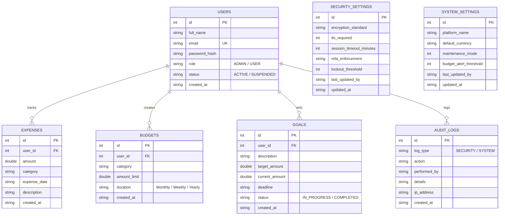

# Online Personal Finance Management Platform (CampusFin)

A simple, manageable, college-level web platform built in **Java** and backed by a **relational database** (MySQL with zero-config embedded SQLite fallback). It helps students and individuals track daily expenses, manage category budgets with live utilization bars, and set goal-oriented savings milestones, while providing an administrative dashboard to manage user accounts, demo security settings, and system configurations.

---

## 1. Technology Stack & Architectural Decisions

| Layer | Technology | Rationale |
|---|---|---|
| **Programming Language** | Java (JDK 17+) | Core object-oriented language required for college syllabus. Clean, strongly typed, and conventional. |
| **Web Server & Routing** | `com.sun.net.httpserver.HttpServer` | Built directly into the Java Standard Library (`jdk.httpserver`). Eliminates heavy Tomcat/Spring Boot download dependencies and runs immediately with standard `javac` and `java`. |
| **Relational Database** | **MySQL 8.x** (with embedded SQLite fallback) | Industry-standard relational database using standard JDBC. Includes `schema.sql` and `data.sql`. If MySQL is not running or unconfigured, it automatically falls back to embedded SQLite so the evaluator never faces startup crashes. |
| **Architecture Pattern** | **MVC + DAO (Data Access Object)** | Classical layered separation: `model` (entities), `dao` (database persistence), `service` (business logic & validation), `web` (REST controllers & static file serving), and `util` (security & helpers). |
| **Frontend UI** | HTML5, Modern CSS3, Vanilla ES6 JavaScript | Clean, responsive student-friendly interface without complex Node.js or npm toolchains. Renders cards, tables, search filters, modal forms, progress bars, and alert banners. |

> **College Scope Compliance:** No microservices, no cloud infrastructure, no external payment gateway integrations, and no real bank credentials stored.

---

## 2. Project Directory Structure

```text
finance-platform/
├── pom.xml                               # Standard Maven build configuration
├── run.bat                               # Windows 1-click batch launcher
├── run.ps1                               # Windows PowerShell launcher
├── README.md                             # Comprehensive project documentation
├── lib/                                  # JDBC Drivers
│   ├── mysql-connector-j-8.3.0.jar       # Official MySQL JDBC Driver
│   ├── sqlite-jdbc-3.45.1.0.jar          # Embedded fallback JDBC Driver
│   ├── slf4j-api-2.0.17.jar              # Logging API
│   └── slf4j-simple-2.0.0-alpha6.jar     # Logging implementation
└── src/
    └── main/
        ├── java/
        │   └── com/finance/
        │       ├── model/                # Entity Data Models
        │       │   ├── User.java
        │       │   ├── Expense.java
        │       │   ├── Budget.java
        │       │   ├── Goal.java
        │       │   ├── SecuritySetting.java
        │       │   ├── SystemSetting.java
        │       │   └── AuditLog.java
        │       ├── dao/                  # Data Access Objects (JDBC SQL queries)
        │       │   ├── UserDAO.java
        │       │   ├── ExpenseDAO.java
        │       │   ├── BudgetDAO.java
        │       │   ├── GoalDAO.java
        │       │   └── SettingsDAO.java
        │       ├── service/              # Business Logic & Input Validation
        │       │   ├── AuthService.java
        │       │   ├── ExpenseService.java
        │       │   ├── BudgetService.java
        │       │   ├── GoalService.java
        │       │   └── AdminService.java
        │       ├── util/                 # Utilities & Connection Managers
        │       │   ├── DatabaseManager.java
        │       │   ├── PasswordUtil.java
        │       │   └── JsonUtil.java
        │       └── web/                  # HTTP Server & API Dispatcher
        │           └── HttpServerApp.java
        └── resources/
            ├── db.properties             # Database credentials & port configuration
            ├── sql/                      # Standalone SQL Setup Scripts
            │   ├── schema.sql            # MySQL DDL table creation statements
            │   └── data.sql              # Initial seed data for test accounts
            └── static/                   # Frontend Web Application Assets
                ├── index.html            # Single-page web dashboard & auth views
                ├── css/style.css         # Modern styling, cards, tables, badges
                └── js/app.js             # Client-side routing, API fetch, UI rendering
```

---

## 3. Database Schema & Tables

The relational database (`finance_db`) consists of 7 normalized tables:



### Table Descriptions:
1. `users`: Stores login credentials, full name, role (`ADMIN` or `USER`), and status (`ACTIVE` or `SUSPENDED`).
2. `expenses`: Records user spending by amount, category, date, and description.
3. `budgets`: Defines spending limits for categories over a duration. Dynamically compared with matching expenses to determine utilization and remaining balance.
4. `goals`: Manages savings targets with deadlines, current progress, remaining amount needed, and completion status.
5. `security_settings`: Holds administrative security policies (demo encryption algorithm, TLS enforcement, session timeout, lockout thresholds).
6. `system_settings`: Holds global preferences (platform name, default currency, budget alert threshold, maintenance mode).
7. `audit_logs`: Records timestamped administrative security events and system configuration changes.

---

## 4. User Roles & Capabilities

### 🛡️ Administrator
* **User Management**:
  - View all registered accounts in a directory with search (by name/email) and filters (by role: All/Admin/User, by status: All/Active/Suspended).
  - Create new user and administrator accounts.
  - Edit user information, reset passwords, change roles, or toggle account status (`ACTIVE` / `SUSPENDED`).
  - Delete user accounts (with cascade deletion of associated records and safeguard preventing self-deletion of the active admin).
  - Friendly confirmation messages on every successful action.
* **Financial-Data Security Settings**:
  - Configure data-at-rest encryption standard (e.g. *AES-256 (Simulated Academic Mode)*, *ChaCha20-Poly1305*), TLS in-transit toggle, session timeout duration, and account lockout threshold.
  - Review the **Security Activity Log** displaying administrative security policy modifications.
  - Prominent educational disclaimer indicating this is an academic policy simulator.
* **System Settings**:
  - Manage platform title, default currency symbol, maintenance mode flag, and budget alert threshold percentage.
  - Review the **Configuration Change Log** capturing all administrative parameter changes.

### 👤 Regular User (Student)
* **Expense Tracking**:
  - Add, edit, and delete expense entries (amount, category, date, optional description).
  - Filter expense history by category dropdown and date range (`From Date` to `To Date`).
  - Overview cards displaying Total Spending, Current Month Spending, and Visual Category Distribution progress bars.
  - Instant confirmation message after saving or deleting.
* **Budget Planning**:
  - Create and edit category budgets with spending limits (e.g. `$200.00` for Food & Dining, `$80.00` for Transportation).
  - Real-time calculation of **Spent Amount**, **Remaining Balance**, and **Utilization Percentage**.
  - Color-coded progress indicators:
    - 🟢 **Green (< 80%)**: Safe spending.
    - 🟡 **Yellow (80% - 99%)**: Approaching budget cap.
    - 🔴 **Red (≥ 100%)**: Over budget alert badge.
* **Financial Goals**:
  - Set financial goals with title, target amount, current savings, and target deadline.
  - Dynamic progress percentage bar and days/amount remaining calculation.
  - Quick **"+ Add Funds" (Deposit)** button to contribute incremental savings toward a goal.
  - Automatic milestone completion badge (**Completed 🎉** vs **In Progress**).

---

## 5. Security & Isolation Architecture

1. **User Data Isolation**:
   - Every expense, budget, and goal query includes `WHERE user_id = ?` matching the authenticated session.
   - Users cannot view, modify, or delete data belonging to other students.
2. **Role-Based Access Control (RBAC)**:
   - Admin API endpoints (`/api/admin/*`) and administration views strictly require `currentUser.getRole().equals("ADMIN")`. Standard users attempting access receive `403 Forbidden`.
3. **Password Security**:
   - Passwords are never stored in plaintext. They are salted and hashed using `SHA-256`.
4. **Input Validation**:
   - All forms validate positive monetary amounts (`amount > 0`), valid ISO dates (`YYYY-MM-DD`), non-empty categories, and valid email formats with friendly client and server error messages.
5. **Privacy Disclaimer**:
   - The platform never collects or stores real bank account numbers, credit card CVVs, or payment card details.

---

## 6. How to Run the Project

### Pre-seeded Demo Accounts for Testing:
| Role | Email Address | Password | Permissions |
|---|---|---|---|
| **Administrator** | `admin@finance.edu` | `Admin@123` | Full access: User management, Security settings, System settings, Overview |
| **Student User** | `student@college.edu` | `User@123` | Standard access: Own expenses, category budgets, financial goals |

*(The login screen also features 1-click test sign-in buttons for both roles!)*

---

### Option A: 1-Click Launch (Recommended - Zero Configuration)
The project comes pre-configured with embedded SQLite fallback so you can run it immediately without starting or configuring MySQL:

1. Open PowerShell or Command Prompt in the `finance-platform/` directory:
   ```powershell
   cd C:\Users\Simran\.gemini\antigravity\scratch\finance-platform
   ```
2. Run the Windows launcher:
   ```cmd
   .\run.bat
   ```
   *Or with PowerShell:*
   ```powershell
   .\run.ps1
   ```
3. Open your web browser to:
   **[http://localhost:8080](http://localhost:8080)**

---

### Option B: Connecting to MySQL Server
If you want to run against your local MySQL Server:

1. Ensure MySQL service is running (e.g. `MySQL80`).
2. Open MySQL Workbench or MySQL CLI:
   ```cmd
   "C:\Program Files\MySQL\MySQL Server 8.0\bin\mysql.exe" -u root -p
   ```
3. Execute the schema and seed scripts:
   ```sql
   source src/main/resources/sql/schema.sql;
   source src/main/resources/sql/data.sql;
   ```
4. Verify or update `src/main/resources/db.properties`:
   ```properties
   db.type=mysql
   db.mysql.url=jdbc:mysql://localhost:3306/finance_db?createDatabaseIfNotExist=true&useSSL=false&allowPublicKeyRetrieval=true&serverTimezone=UTC
   db.mysql.username=root
   db.mysql.password=YOUR_MYSQL_ROOT_PASSWORD
   ```
5. Run `.\run.bat` or `.\run.ps1`. The platform will automatically connect to MySQL!

---

### Option C: Using Maven (IntelliJ / Eclipse / VS Code)
If you import the project into an IDE:
- Open `finance-platform` as a Maven project.
- Main class to run: `com.finance.web.HttpServerApp`.
- Command line Maven:
  ```bash
  mvn clean compile exec:java
  ```

---

## 7. Explanation of Core Classes

| Class | Location | Purpose |
|---|---|---|
| `HttpServerApp` | `com.finance.web` | Application entry point (`main`), HTTP server initialization on port 8080, route dispatching, session token authentication, and static asset serving. |
| `DatabaseManager` | `com.finance.util` | Handles JDBC connections, reads `db.properties`, provides seamless fallback from MySQL to embedded SQLite, creates tables, and seeds initial data. |
| `UserDAO` | `com.finance.dao` | CRUD database operations for user accounts, search queries by name/email, and filtering by role/status. |
| `ExpenseDAO` | `com.finance.dao` | Executes SQL queries for expenses with date/category filters, total spending sums, and category breakdown aggregations. |
| `BudgetDAO` | `com.finance.dao` | Manages budget limits and computes real-time spending utilization against the user's recorded expenses. |
| `GoalDAO` | `com.finance.dao` | Tracks financial milestone targets, processes deposit increments, and computes completion percentages. |
| `SettingsDAO` | `com.finance.dao` | Persists security and system configurations, and inserts audit logs for all administrative actions. |
| `AuthService` | `com.finance.service` | Validates registration, handles logins, generates session tokens, and enforces password complexity and hashing. |
| `AdminService` | `com.finance.service` | Provides user moderation, security policy updates, system setting adjustments, and audit log generation. |
| `PasswordUtil` | `com.finance.util` | Hashes and verifies passwords using SHA-256 with an application-level cryptographic salt. |
| `JsonUtil` | `com.finance.util` | Lightweight, zero-dependency JSON serializer and parser for API requests and responses. |
